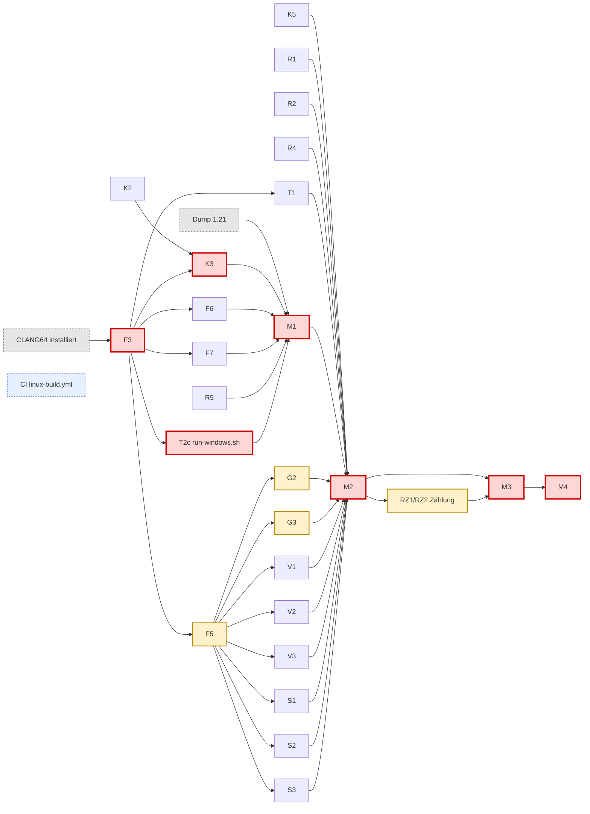

# ReFueled – Arbeitspakete, Abhängigkeiten, Auslastung

Stand 2026-10-13 (Planänderung: kein WSL/Linux lokal, Linux-Prüfung nur in CI). Status: `blocked` / `ready` / `in_progress` / `review` / `done` / `deferred-ci` (Linux-Prüfung, läuft erst in GitHub Actions, blockiert nichts).
Modell: **O** = Opus, **S** = Sonnet (Opus prüft jeden Diff und committet). Umfang: S ≈ < 300
geänderte Zeilen, M ≈ 300–1000, L > 1000 oder viel Iteration.
Besessene Dateien darf nur das genannte Paket ändern. `runtime.h`, `gpu/bbgpu.h` und
`src/platform/pf_*.h` gehören immer Opus.

Gemeinsame Abnahme für **jedes** Paket (zusätzlich zur Paketzeile): kompiliert unter Windows
(MSYS2 CLANG64; bis CLANG64 da ist: MSVC-Zwischenlauf, wo möglich, sonst "ungebaut" im Log);
mindestens ein Test; `docs/refueled/log/<ID>.md` mit alt↔neu-Tabelle für jede Linux-wirksame
Änderung (Opus prüft beim Merge die Linux-Gleichheit per Review und vermerkt das im Log);
Pflichtfeld `Verhaltensabweichung Linux: keine / <Beschreibung>` im Log (Opus prüft es beim Merge;
ungleich "keine" = Entscheidung Opus, Meldung an die Projektleitung im nächsten Bericht, Eintrag in D21);
`linux_hits.py` fällt oder bleibt gleich. Linux-Build und Linux-Tests laufen nur in CI
(`.github/workflows/linux-build.yml`, aktiv sobald das GitHub-Repo existiert) – Status `deferred-ci`.

## 1. Pakete

### Phase 0/1 (erledigt)
| ID | Beschreibung | Modell | Status |
|---|---|---|---|
| P0 | Branch, Toolchain-Bestand, shadPS4-Referenz + Worktree b4e7ae7, Metrik-Werkzeug, Baseline | O (+S Toolchain-Bestand, S Paketrecherche) | done |
| P1 | U1, U2, Architektur, Schnittstellen-Header, Plan | O | done (Freigabe 2026-10-13) |

### Welle 1 – Fundament
| ID | Beschreibung | Besessene Dateien | Abhängig von | Abnahme | Umfang | Modell | Status |
|---|---|---|---|---|---|---|---|
| F1 | Schnittstellen nach Review einfrieren (IF-2) | `src/platform/pf_*.h`, INTERFACES.md | P1 | Header kompilieren C11/C++23, beide Zweige; Protokoll aktualisiert | S | O | done (IF-2) |
| F2 | Windows-Stubs für alle pf_*-Funktionen + `pf_common.c` | `src/platform/pf_common.c`, `src/platform/pf_*_win32.c` (Übergabe an K1/K4/K6/K7/R2/R3, sobald diese starten) | F1 | Jede Funktion vorhanden, Rückgabe `PF_ENOSYS` + Meldung; `tests/refueled/test_stubs.c` ruft alle auf | S | S | done (74edd1f) |
| F3 | Windows-Build: `build-windows.sh` (MSYS2 CLANG64) für Plattformschicht + `WIN32_SOURCES.txt` + Testprogramme; Flags `-std=c11 -D_GNU_SOURCE -D_FILE_OFFSET_BITS=64 -include pf_posix_gap_win32.h -gcodeview`, `-Wl,--disable-high-entropy-va,--pdb=` | `build-windows.sh`, `src/platform/WIN32_SOURCES.txt`, `tests/refueled/test_stubs.c` | F2, Toolchain | `bash build-windows.sh --test` grün in CLANG64 | M | S | review: Skript fertig, Abnahme in CLANG64 offen (Toolchain fehlt) |
| F4 | Linux-Build nimmt Plattformquellen auf (`src/platform/pf_*_linux.c`, `pf_common.c` in `runtime=` von build.sh), sonst nichts | `build.sh` | F1, F8 | `build.sh --test` in WSL grün; `out/sacredfire` startet `--list-imports` wie vorher (Ausgabe-Diff leer) | S | S | done (630001d, Opus); Linux-Build deferred-ci |
| F5 | GPU-CMake-Zweig für Windows (`if(WIN32)`: STATIC, ohne X11/`--allow-shlib-undefined`/`-ftls-model`, miniz/magic_enum/xbyak über `tools/deps-windows.sh`) | `gpu/CMakeLists.txt`, `tools/deps-windows.sh` | F1, Toolchain | `cmake -S gpu` konfiguriert in CLANG64; Linux-Konfiguration bitgleich (CMakeCache-Diff der Linux-Optionen leer) | M | S | review: CMake-Zweig fertig, Abnahme cmake in CLANG64 offen |
| F6 | POSIX-Teilmenge auf Windows prüfen + Lücken schließen | `src/platform/pf_posix_gap_win32.h/.c`, `tests/refueled/test_posix_subset.c` | F3 | Test deckt jede (P)-Zeile in INTERFACES.md §2 ab, grün auf beiden Plattformen | M | S | review: Entwurf gemerged; Abnahme test_posix_subset in CLANG64 |
| F7 | ABI-Verifikation: Asm-"Gast"-Aufrufer gegen `ABI`-Funktionen; Audit Host→Gast-Aufrufe ohne ABI in src/, gpu/shim, bbport-Zeilen | `tests/refueled/test_sysv_abi.c`, `tests/refueled/sysv_caller.S`, `docs/refueled/audit/ABI.md` | F3 | Test grün auf Windows (Register-/Stack-Args, Float, sret, Callback, Ausrichtung, xmm6–15); Audit-Liste vollständig mit Datei:Zeile | M | S | review: Test Linux grün (149), Audit fertig; Windows-Lauf in CLANG64 offen |
| F8 | Linux-Regressionsumgebung in WSL (nach deiner Entscheidung Nix/apt) + Skript | `docs/refueled/tools/linux-regress.sh` | Freigabe Installation | Skript baut den **unveränderten** Stand f1f7935 und protokolliert `build.sh --test` + Python-Tests als Referenz | S | S | deferred-ci (ersetzt durch .github/workflows/linux-build.yml, Paket CI) |
| F9 | Audit Low-Heap: alle Host-Allokationen, deren Adresse der Gast sieht | `docs/refueled/audit/LOWHEAP.md` | P1 | Liste Datei:Zeile + Begründung; Opus bestätigt | S | S | done |
| F10 | Audit LLP64: `long`, `off_t`, `time_t`, `struct timespec`, `wchar_t`, `ssize_t` in Gast-Strukturen und ABI-Signaturen | `docs/refueled/audit/LLP64.md` | P1 | Liste + Fix-Vorschlag je Stelle | S | S | done |
| LH | **Low-Heap unter 1 TiB** (eigenes Paket, Freigabe 2026-10-13): plattformneutraler Allokator auf einem übergebenen Bereich (calloc/aligned_alloc/free, Mutex, Größen-Header, Freiliste mit Verschmelzen, Assertion "Zeiger < 1 TiB"), Windows-`pf_low_*` darauf, Linux-`pf_low_*` = calloc/aligned_alloc/free | `src/platform/pf_lowheap.c`, `src/platform/pf_lowheap.h` (intern, nur src/platform), `src/platform/pf_lowheap_linux.c`, `src/platform/pf_lowheap_win32.c`, `tests/refueled/test_lowheap.c` | F1 | Test auf Linux (WSL gcc) und Windows: Ausrichtung 16…64 KiB, Nullen, Wiederverwendung nach free, Verschmelzen, Erschöpfung → NULL, 8 Threads parallel, alle Zeiger im Bereich | M | S | done (Windows-Lauf in CLANG64 offen) |

### Kritischer Pfad (Runtime-Kern)
| ID | Beschreibung | Besessene Dateien | Abhängig von | Abnahme | Umfang | Modell | Status |
|---|---|---|---|---|---|---|---|
| K1 | **pf_memory Windows**: Layout-Platzhalter, Section, feste Sichten mit Split/Coalesce, Schutz, Nullen, lazy, Low-Heap, sicheres Lesen | `src/platform/pf_memory_win32.c`, `tests/refueled/test_memory.c` | F2, F3 | Test: Aliasing zweier Sichten, Ersetzen, Teil-Unmap + Neu-Map bei 16 KiB, Schutz/Fault, Nullen, erste low-Allokation = 0x800000000, Low-Heap < 1 TiB (Allokator aus LH) | L | O | done (MSVC-Zwischenlauf 85 grün; CLANG64-Abnahme offen) |
| K2 | **pf_memory Linux** (verschobener Code) + Umstellung `runtime_memory.c` (mmap/memfd/fallocate/mprotect → pf_*, PROT → PF_PROT, Chunk-fd → PfMemHandle, `#ifdef _WIN32`-Rest entfernen, Layout-Reservierung + Low-Heap-Init) | `src/runtime_memory.c`, `src/platform/pf_memory_linux.c` | F1, F4, F10 | Linux: Tests grün, Meldungstexte identisch, Zeilenvergleich alt/neu im Log; Windows: `runtime_memory.c` kompiliert | M | S | done als Code (Linux-Review); Kompilat CLANG64 offen |
| K3 | **Loader** `probe.c`: allocate/protect → pf_vm, Fault-Kette → pf_fault_add_handler, Bericht → pf_symbolize/pf_describe_mapping/pf_backtrace, Watchdog → pf_watchdog_start + pf_thread_sample, Neustart, `enter_on_stack` → pf_call_guest_on_stack, mallopt → pf_init, `pf_tls_patch_image`; `_WIN32`-Zweige raus | `src/probe.c`, `src/runtime.h` | K2, F1 | Linux: `--list-imports`-Ausgabe identisch, Fault-Bericht-Format identisch; Windows: kompiliert | M | O | done als Code (Opus, Linux-Review); Kompilat CLANG64 offen |
| K4 | **pf_tls Windows**: Slot, Set/Get, Patch-Scanner | `src/platform/pf_tls_win32.c`, `tests/refueled/test_tls.c` | F2, F3 | Test: synthetischer Code mit `gs:[0]`-Load liefert nach Patch den gesetzten TCB, in 2 Threads verschieden | S | O | done (MSVC 10 / Linux 8 grün; CLANG64-Abnahme offen) |
| K5 | **Threads Linux** (verschobener Code) + Umstellung `runtime_thread.c` (set_gs → pf_tls, Stack → pf_thread_create_on_stack, Namen, IDs, setjmp → pf_setjmp, calloc/aligned_alloc → pf_low_*) | `src/runtime_thread.c`, `src/platform/pf_thread_linux.c`, `src/platform/pf_tls_linux.c` | F1, F4, F9 | Linux: Tests grün (test_runtime, test_sema, test_eventflag); Windows: kompiliert | M | S | done als Code (Linux-Review); Kompilat CLANG64 offen |
| K6 | **pf_thread Windows** + Asm (Stackwechsel mit TEB-Grenzen, Gast-Aufruf, pf_setjmp/longjmp), Sampling, Thread-Liste, Namen, CPU-Zeit, Priorität | `src/platform/pf_thread_win32.c`, `src/platform/pf_stack_win32.S`, `src/platform/pf_jmp_win32.S`, `tests/refueled/test_thread.c` | F2, F3, LH | Test: Thread auf low-Stack mit >64 KiB Rahmen (`__chkstk`), Ausnahme auf Gast-Stack wird behandelt, pf_longjmp aus tiefer Rekursion, Sampling liest RIP eines laufenden Threads | L | O | done bis auf CLANG64-Abnahme (jmp per ms_abi unter Linux grün, C-Teil MSVC 14 grün; Stackwechsel mit TEB-Grenzen erst in CLANG64 prüfbar) |
| K7 | **pf_exception Windows**: VEH-Dispatcher, PfContext, Breakpoint-RIP-Normalisierung, Resume, Watchdog-Thread, exit_now | `src/platform/pf_exception_win32.c`, `tests/refueled/test_exception.c` | K6 (pf_jmp) | Test: Schreib-Fault auf geschützter Seite → Handler hebt Schutz auf → Fortsetzung; Rücksprung; int3; Einzelschritt; unbehandelt → Prozessende mit Code | M | O | done bis auf CLANG64-Abnahme (MSVC 23 grün; test_resume nach CLANG64) |
| K8 | **pf_exception/pf_log Linux** (verschobener Code: sigaction-Dispatcher mit gleichen Flags, resume = siglongjmp, alarm/SIGALRM, Sampling per tgkill+Signal) | `src/platform/pf_exception_linux.c`, `src/platform/pf_log_linux.c`, `tests/refueled/test_exception.c` (gemeinsam mit K7: Linux-Teil) | F1, F4 | Linux: Test grün; Watchdog-Ausgabe im alten Format | M | S | done (Linux-Test 32 grün) |
| M1 | **Meilenstein 1**: Windows-Build Runtime + Loader; `--list-imports` mit dem Spiel; Image bei 0x800000000 | – (nur Integration) | K1, K2, K3, F6, F7, T2 | Log-Belege: "Mapped … bytes" bei 0x800000000, Import-Zusammenfassung identisch zur Linux-Referenz | – | O | blocked |
| M2 | **Meilenstein 2**: Init bis zum ersten GPU-Submit | – | M1, K4–K8, R1–R5, G2, G3, V1–V3, S1–S3, T1 | Log: erstes `submit`/DCB des GPU-Threads | – | O | blocked |
| M3 | **Meilenstein 3**: Hauptmenü | – | M2 + Bugfix-Welle | Screenshot + Log "changeHeroAndOutfit" | – | O | blocked |
| M4 | **Meilenstein 4**: Arcade-Rennen mit Sound, Controller, Speichern | – | M3, R4 | Log + Speicherdatei geschrieben | – | O | blocked |

### GPU-Strang (fast kritisch)
| ID | Beschreibung | Besessene Dateien | Abhängig von | Abnahme | Umfang | Modell | Status |
|---|---|---|---|---|---|---|---|
| G2 | shadPS4-Kopie Teil 1 unter CLANG64 übersetzen: `common/`, `shader_recompiler/` (`refueled:`-Marker, minimal) | `gpu/shadps4/common/**`, `gpu/shadps4/shader_recompiler/**` | F5 | Alle Objektdateien dieser Ordner bauen; Linux-Build unverändert | L | S | blocked |
| G3 | shadPS4-Kopie Teil 2: `video_core/**` und `core/libraries/**` ohne die V-Dateien | `gpu/shadps4/video_core/**`, `gpu/shadps4/core/**` (ohne V1–V3-Dateien) | F5 | wie G2 | L | S | blocked |
| V1 | `page_manager.cpp/.h` bbport-Linux-Zeilen → pf_* (uffd bleibt unter `__linux__`) | `gpu/shadps4/video_core/page_manager.*` | F5, F1 | Linux unverändert; Windows kompiliert; Seitenverfolgung über pf_vm_protect | M | S (O-Review Zeile für Zeile) | done als Code (Linux-Review) |
| V2 | Diagnose in vendored Dateien: liverpool, vk_scheduler, vk_rasterizer, vk_pipeline_cache (pf_sigsetjmp), vk_draw_pipe.h, buffer_cache.cpp, videoout/driver.cpp | diese Dateien | F5, F1 | wie V1 | M | S | done als Code (Linux-Review) |
| V3 | Gast-GPU-Speicher (dma-buf) hinter Shim-Helfer; Windows "nicht unterstützt" | `gpu/shim/bbport_guest_memory.*`, `gpu/shadps4/video_core/buffer_cache/buffer.*`, `gpu/shadps4/video_core/renderer_vulkan/vk_instance.*` | F5, F1 | Linux unverändert; Windows: PC-Modell meldet "aus" | M | S | done als Code (Linux-Review) |
| S1 | Shim-Hooks: free_check, guest_hooks → pf_fault_add_handler, PfContext, pf_vm_protect | `gpu/shim/bbport_free_check.*`, `gpu/shim/bbport_guest_hooks.*` | F1, F5 | wie V1 | M | S | done als Code (Linux-Review) |
| S2 | Shim-Diagnose: clobber, write_log, wait_trace, threads.h, gnm_hooks, bbgpu.cpp, signals.h, `gpu/bbgpu.h`-Signaturen (Ausführung durch Opus) | `gpu/shim/bbport_clobber.*`, `bbport_write_log.*`, `bbport_wait_trace.cpp`, `bbport_threads.h`, `bbport_gnm_hooks.*`, `bbgpu.cpp`, `gpu/shim/core/signals.h` | F1, F5 | wie V1 | M | S | done als Code (Linux-Review) |
| S3 | Fenster/Overlay: `window.cpp`, `sdl_window.h`, `bbport_overlay.cpp` (incbin-Section `.rodata` → plattformneutral) | diese Dateien | F5 | Windows kompiliert, Linux unverändert | S | S | done als Code (Linux-Review) |

### Runtime außerhalb des Kerns
| ID | Beschreibung | Besessene Dateien | Abhängig von | Abnahme | Umfang | Modell | Status |
|---|---|---|---|---|---|---|---|
| R1 | `runtime_kernel.c`: Sampler, Wait-Sites, getattr_np, gettid, /proc, ucontext → pf_* | `src/runtime_kernel.c` | F1, F4, F9 | Linux unverändert; Windows kompiliert | M | S | done als Code (R1+R1b, Linux-Review); Kompilat CLANG64 offen |
| R2 | Dateien/Spielstände: nftw → pf_fs_remove_tree, rename-Stellen, Pfade, Binärmodus prüfen; pf_fs beide Plattformen | `src/runtime_savedata.c`, `src/runtime_file.c`, `src/platform/pf_fs_linux.c`, `src/platform/pf_fs_win32.c`, `tests/refueled/test_fs.c` | F1, F3, F4, F6 | Test: Baum löschen, atomar ersetzen, Spielstand-Roundtrip | M | S | in_progress: Plattformteil + R2b done; offen: PfStat/d_type in runtime_file.c (Entscheidung Opus), Wände in runtime_file.c/savedata.c |
| R3 | pf_process + pf_log beide Plattformen (Symbole, Backtrace, Mapping-Zeile, Speicher, Neustart, stderr) | `src/platform/pf_process_linux.c`, `pf_process_win32.c`, `pf_log_win32.c`, `tests/refueled/test_process.c` | F1, F3, F4 | Test: Symbol einer bekannten Funktion, Backtrace ≥ 3 Frames, Mapping-Zeile des Stacks | M | S | in_progress: Plattformteil done (Linux 21, MSVC 19 grün); Aufrufer in K3/V2 |
| R4 | Audio, Pad, AJM unter Windows (SDL3), Controller-Neuscan | `src/runtime_audio.c`, `src/runtime_pad.c`, `src/runtime_ajm.c` | F3, F6 | Windows kompiliert; `test_pad` grün | S | S | done als Code (Linux-Review); Kompilat CLANG64 offen |
| R5 | Restliche Runtime-Dateien kompilieren unter Windows (POSIX-Teilmenge, LLP64-Fixes aus F10, Low-Heap-Fixes aus F9) | `src/runtime.c`, `runtime_services.c`, `runtime_rtc.c`, `runtime_time.c`, `runtime_mutex.c`, `runtime_rwlock.c`, `runtime_sema.c`, `runtime_eventflag.c`, `runtime_content.c`, `runtime_json2.c`, `src/vulkan_smoke.c` | F3, F6, F9, F10 | Windows kompiliert; Linux-Tests grün | M | S | in_progress: R5a done; Kompilat aller übrigen Dateien unter CLANG64 |
| T1 | Bestehende Tests unter Windows (`build-windows.sh --test`: test_runtime, test_sema, test_eventflag, test_pad, test_content, test_file_mods) | `tests/*.c` (nur nötige Minimaländerungen) | F3, R5 | alle grün auf Windows | M | S | blocked |
| T2 | Skripte unter Windows: prepare/link/patches/game_check in MSYS2-Python, `run-windows.sh` | `run-windows.sh`, `scripts/*.py` (nur Portabilitätsfixes) | F3 | `prepare.py` + `link_modules.py` erzeugen auf Windows dieselben Ausgabedateien wie auf Linux (sha256 gleich) | M | S | in_progress: T2a + T2b done; run-windows.sh folgt mit CLANG64 |

### Nachträge Welle A (2026-10-13)
| ID | Beschreibung | Besessene Dateien | Abhängig von | Modell | Status |
|---|---|---|---|---|---|
| CI | Linux-Regression in GitHub Actions (vorbereitet, nicht aktiv) | `.github/workflows/linux-build.yml`, `docs/refueled/tools/linux-platform-tests.sh` | – | S | done (deferred-ci) |
| IF-5…IF-9 | Schnittstellen: runtime.h/bbgpu.h auf pf_*, Layout-Init, Zugriffsart, pf_time.h, Zufall/CPU-Zeiten/CPU-Nummer, PfStat | Header + pf_*_linux/win32.c | – | O | done (MSVC-Läufe grün) |
| R2c | runtime_file.c/runtime_savedata.c ohne Windows-Stub-Wände (PfStat, PF_DIRENT_TYPE) | diese zwei Dateien | IF-9, F6 | S | done als Code (Linux-Review); Kompilat CLANG64 offen |
| F3b | build-windows.sh baut sacredfire.exe (Runtime, Loader, LibAtrac9, GPU-Lib per CMake, UTF-8-Manifest, Link) | build-windows.sh, WIN32_SOURCES.txt, packaging/windows/* | F3, F5 | S | done als Code (0733127); --keep-going-Zählmodus ergänzt; ungetestet bis CLANG64 |
| T2c | run-windows.sh (Ablauf wie run.sh, Löschschutz für den Spielordner, CRLF-feste ini-Abfragen) | run-windows.sh | T2a | S | done (9bd1997; Selbsttest 11/11, BB_RESTART_COMMAND) |
| TLS | Statische TLS-Analyse: alle fs:/gs:-Zugriffe in eboot + Modulen gegen link_*.py-Umschreibung und pf_tls_patch_image (nur Zählungen/Offsets) | tools/tls_scan.py, audit/TLS-SCAN.md | – (mit 1.21 wiederholen) | S | in_progress |
| DBG | M2-Debug: BB_CRASH_DETAIL (Register, Gast-Stack, rbp-Kette, Image-Offsets), BB_TRACE_IMPORTS (Thunks), Anleitung DEBUG-M2.md; Linux ohne Schalter unverändert | src/probe.c (Fault-Bericht, Bindungsschleife), run-windows.sh, DEBUG-M2.md | – | S (O-Review) | in_progress |
| HYP | Hypothesen-Protokoll M2: bis 3 Hypothesen parallel in eigenen Worktrees | M2-HYPOTHESEN.md | – | O | done (Regel) |
| M3S | M3-Strang parallel zu M1/M2: G2/G3-Rest, Fenster, Vulkan-Init mit Testbild | gpu/** (je Teilpaket) | erster vollständiger Build | S je Teilpaket, O Merge | blocked (CLANG64) |
| ML0 | Mod-Loader-Architekturentwurf (Overlay, Hooks, Lade-API) | MODLOADER.md | – | O | done (Entwurf) |

### Später / bei Bedarf
| ID | Beschreibung | Abhängig von | Umfang | Modell | Status |
|---|---|---|---|---|---|
| RZ | Red-Zone-Schutz (shadPS4 `WindowsGuestRedZoneProtection` portieren), Schalter `BB_REDZONE=0/1`; **eingeplant, fertig spätestens vor M3** (Freigabe 2026-10-13); ab M2 jeder unerklärliche Absturz zuerst RZ an/aus A/B | K3, K7 | L | O+S | in_progress: Vorstudie done (audit/REDZONE.md: RZ1 Zählung + RZ2 Funktionsliste zuerst) |
| D1 | Bauanleitung Windows `docs/refueled/BUILD-WINDOWS.md` | M2 | S | S | blocked |
| P2 | Paketierung Windows (zip: exe + DLLs + Lizenzen) | M3 | M | S | blocked |
| P3 | Launcher unter Windows (GTK4-Python oder Alternative, eigene Entscheidung) | M4 | M | S | blocked |
| B* | Bugfix-Pakete M3/M4 (werden nach M2 geschnitten) | M2 | – | O/S | – |

**Summe:** 43 Pakete (P0, P1, F1–F10, K1–K8, M1–M4, G2, G3, V1–V3, S1–S3, R1–R5, T1, T2, RZ, D1, P2, P3),
davon 30 Sonnet-Pakete; Opus: F1, K1, K3, K4, K6, K7, RZ (mit), M1–M4 + alle Reviews und Merges.

## 2. Abhängigkeitsgraph (neu berechnet 2026-10-13, ohne Linux-Abhängigkeiten)

Erledigt und daher nicht mehr im Graphen: P0, P1, F1, F2, F4, F9, F10, LH, K1, K4, K6, K7, K8,
K2a, K5a, R2/R3-Plattformteile, T2a/T2b, RZ-Vorstudie. Die Kanten von F4/F8 (Linux-Umgebung) zu
K2/K5/K8/R1 entfallen; Linux-Prüfungen hängen als `deferred-ci` an niemandem.

**Kritischer Pfad (rot):** CLANG64 → F3-Abnahme (`build-windows.sh --test`) → F3b (sacredfire.exe)
→ K3-Kompilat → T2c (run-windows.sh) → M1 (+ Dump 1.21) → M2 → M3 → M4.
**Nachtrag 2026-10-13:** M1 verlangt eine Import-Zusammenfassung identisch zur Linux-Referenz; dazu
muss `bbgpu_resolve` die GPU-Importe auflösen, die Exe also die übersetzte GPU-Bibliothek enthalten.
**G2/G3 liegen damit schon vor M1 auf dem kritischen Pfad** (nicht erst vor M2).
**Fast kritisch (gelb):** F5 → G2/G3 (shadPS4-Kopie unter MinGW, größter unbekannter Block; wird
nach M1 voraussichtlich kritisch, darum sofort nach F3 parallel), danach V*/S*-Kompilat, RZ1/RZ2
vor M3. Alle Aufrufer-Umstellungen (K2, K5, R1, R2b, R4, R5a, S1–S3, V1–V3) laufen schon jetzt als
Code und werden mit CLANG64 nur noch übersetzt und repariert.

## 3. Wellen und Auslastung

Keine feste Obergrenze für Agenten; ein freier Agent nimmt das höchstpriorisierte `ready`-Paket
(fortsetzen statt neu starten). Priorität: 1 kritischer Pfad, 2 G2/G3, 3 meiste Folgepakete, 4 Rest.
Zwischenprüfung bis CLANG64: MSVC (VS Build Tools) für reine Win32-Dateien; kein WSL.

| Welle | Opus | Sonnet parallel | Schaltet frei |
|---|---|---|---|
| A (jetzt, ohne CLANG64) | IF-5/IF-6, K3 als Code, Reviews/Merges mit Linux-Gleichheitsprüfung | CI, K2, K5, R1, R2b, R4, R5a, F6 (Entwurf), S1, S2, S3, V1, V2, V3 | alles für M1/M2 als Code |
| B (CLANG64 da) | F3-Abnahme, K3 übersetzen, M1-Vorbereitung | F5-Abnahme → G2a, G2b, G3a, G3b, G3c parallel; F6/F7/T1-Abnahme; Kompilierfehler der Welle-A-Pakete (je Besitzer); T2c | M1 (sobald Dump 1.21) |
| C | M1 (Image bei 0x800000000, Importe), dann M2-Integration | Rest G*/V*/S*, R4/R5-Kompilat, RZ1/RZ2 | M2 |
| D+ | M2 → Bugfix-Planung M3/M4, RZ-Entscheidung | B-Pakete, D1, P2, P3 | M3, M4 |

### Wo Leerlauf droht und was dagegen hilft

| Engpass | Wirkung | Gegenmaßnahme |
|---|---|---|
| CLANG64 noch nicht installiert | nichts übersetzbar außer reinem Win32 (MSVC) | Welle A schreibt alles als Code vor; F3/F5/G* starten ohne Rückfrage, sobald CLANG64 da ist |
| Dump 1.21 fehlt | M1-Tests blockiert | alle Arbeiten bis vor M1 weiter; M1 erst, wenn game_check.py sauber durchläuft |
| G2/G3 unbekannt groß | M2 verschiebt sich | direkt nach F5 in 5 Teilpaketen parallel (audit/GPU-MINGW.md) |
| Opus seriell (K3, Merges, Linux-Review) | Review-Stau | Pakete liefern alt↔neu-Tabellen; Review in Prioritätsreihenfolge |
| Kein Linux-Build | Linux-Fehler bleiben bis CI unentdeckt | Linux-Gleichheit per Review (Tabellen), CI-Workflow vorbereitet |

## 4. Agenten-Budget (bis 2026-10-12; ab Phase 2 aufgehoben, siehe §3)

| Zweck | Agenten |
|---|---|
| Bereits verbraucht (Phase 0/1: Toolchain-Bestand, Paketrecherche) | 2 |
| Sonnet-Pakete (je 1 Agent, Nacharbeit über denselben Agenten) | 30 |
| Reserve: Aufteilung G2/G3, Bugfix-Pakete M3/M4, RZ | 12 |
| Puffer | 6 |
| **Summe** | **50** |
